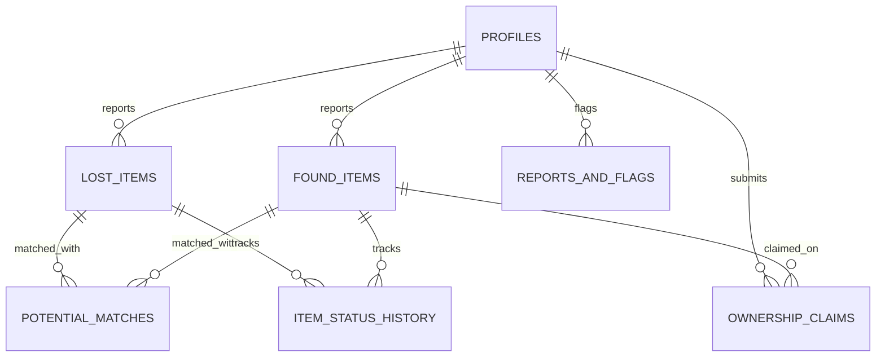

# FoundLoop – Database Schema & Supabase Setup

## 1. Schema Diagram (ERD)



---

## 2. Table Specifications

### 1. `profiles`
Extends `auth.users` with application-specific user metadata and role-based permissions.
* `id` (UUID, Primary Key, references `auth.users.id` on delete cascade)
* `email` (TEXT, Not Null)
* `full_name` (TEXT)
* `phone_number` (TEXT, Nullable, Private)
* `role` (TEXT, Default `'user'`, Check in `('user', 'moderator', 'admin')`)
* `avatar_url` (TEXT)
* `is_suspended` (BOOLEAN, Default `false`)
* `created_at` (TIMESTAMPTZ, Default `NOW()`)
* `updated_at` (TIMESTAMPTZ, Default `NOW()`)

### 2. `lost_items`
Stores reports of items lost by users.
* `id` (UUID, Primary Key, Default `gen_random_uuid()`)
* `user_id` (UUID, Not Null, references `profiles.id` on delete cascade)
* `title` (TEXT, Not Null)
* `category` (TEXT, Not Null, Check in `('Electronics', 'Documents', 'Wallets', 'Bags', 'Accessories', 'Keys', 'Clothing', 'Others')`)
* `description` (TEXT, Not Null)
* `brand` (TEXT)
* `primary_color` (TEXT, Not Null)
* `secondary_color` (TEXT)
* `lost_date` (DATE, Not Null)
* `city` (TEXT, Not Null)
* `approximate_location` (TEXT, Not Null)
* `latitude` (NUMERIC, Nullable)
* `longitude` (NUMERIC, Nullable)
* `image_url` (TEXT, Nullable)
* `private_identifying_details` (TEXT, Not Null) -- PRIVATE: only visible to owner & admin/mod
* `status` (TEXT, Default `'REPORTED'`, Check in `('REPORTED', 'MATCH_PENDING', 'CLAIM_SUBMITTED', 'VERIFIED', 'RETURNED', 'CLOSED')`)
* `created_at` (TIMESTAMPTZ, Default `NOW()`)
* `updated_at` (TIMESTAMPTZ, Default `NOW()`)

### 3. `found_items`
Stores reports of items recovered by finders.
* `id` (UUID, Primary Key, Default `gen_random_uuid()`)
* `user_id` (UUID, Not Null, references `profiles.id` on delete cascade)
* `title` (TEXT, Not Null)
* `category` (TEXT, Not Null, Check in `('Electronics', 'Documents', 'Wallets', 'Bags', 'Accessories', 'Keys', 'Clothing', 'Others')`)
* `description` (TEXT, Not Null)
* `brand` (TEXT)
* `primary_color` (TEXT, Not Null)
* `secondary_color` (TEXT)
* `found_date` (DATE, Not Null)
* `city` (TEXT, Not Null)
* `approximate_location` (TEXT, Not Null)
* `latitude` (NUMERIC, Nullable)
* `longitude` (NUMERIC, Nullable)
* `image_url` (TEXT, Nullable)
* `custody_type` (TEXT, Default `'WITH_FINDER'`, Check in `('WITH_FINDER', 'POLICE_STATION', 'SECURITY_DESK', 'LOST_AND_FOUND_OFFICE')`)
* `custody_details` (TEXT)
* `status` (TEXT, Default `'AVAILABLE'`, Check in `('AVAILABLE', 'CLAIM_UNDER_REVIEW', 'OWNERSHIP_VERIFIED', 'RETURNED', 'CLOSED')`)
* `created_at` (TIMESTAMPTZ, Default `NOW()`)
* `updated_at` (TIMESTAMPTZ, Default `NOW()`)

### 4. `potential_matches`
Stores smart-matching pairs calculated by the weighted engine.
* `id` (UUID, Primary Key, Default `gen_random_uuid()`)
* `lost_item_id` (UUID, Not Null, references `lost_items.id` on delete cascade)
* `found_item_id` (UUID, Not Null, references `found_items.id` on delete cascade)
* `similarity_score` (INT, Not Null) -- 0 to 100
* `tier` (TEXT, Not Null, Check in `('HIGH', 'MEDIUM', 'LOW')`)
* `matched_fields` (TEXT[], Not Null) -- e.g. `ARRAY['category', 'city', 'brand']`
* `reasons` (TEXT[], Not Null)
* `status` (TEXT, Default `'SUGGESTED'`, Check in `('SUGGESTED', 'REVIEWED', 'CLAIM_INITIATED', 'DISMISSED')`)
* `created_at` (TIMESTAMPTZ, Default `NOW()`)

### 5. `ownership_claims`
Stores verification claims submitted by users asserting ownership over a found item.
* `id` (UUID, Primary Key, Default `gen_random_uuid()`)
* `found_item_id` (UUID, Not Null, references `found_items.id` on delete cascade)
* `lost_item_id` (UUID, Nullable, references `lost_items.id` on delete set null)
* `claimant_id` (UUID, Not Null, references `profiles.id` on delete cascade)
* `claim_description` (TEXT, Not Null)
* `private_proof_answers` (TEXT, Not Null) -- Specific serials, wallpaper, secret marks
* `proof_image_url` (TEXT, Nullable) -- Purchase bill / old photo
* `status` (TEXT, Default `'SUBMITTED'`, Check in `('SUBMITTED', 'UNDER_REVIEW', 'APPROVED', 'REJECTED', 'HANDED_OVER')`)
* `reviewer_id` (UUID, Nullable, references `profiles.id`)
* `review_notes` (TEXT)
* `created_at` (TIMESTAMPTZ, Default `NOW()`)
* `updated_at` (TIMESTAMPTZ, Default `NOW()`)

### 6. `item_status_history`
Maintains an immutable timeline of state transitions for lost and found items.
* `id` (UUID, Primary Key, Default `gen_random_uuid()`)
* `item_type` (TEXT, Not Null, Check in `('LOST', 'FOUND', 'CLAIM')`)
* `item_id` (UUID, Not Null)
* `previous_status` (TEXT)
* `new_status` (TEXT, Not Null)
* `changed_by` (UUID, Not Null, references `profiles.id`)
* `notes` (TEXT)
* `created_at` (TIMESTAMPTZ, Default `NOW()`)

### 7. `reports_and_flags`
Allows users to report fraudulent, offensive, or duplicate listings.
* `id` (UUID, Primary Key, Default `gen_random_uuid()`)
* `reporter_id` (UUID, Not Null, references `profiles.id`)
* `item_type` (TEXT, Not Null, Check in `('LOST', 'FOUND', 'CLAIM', 'USER')`)
* `item_id` (UUID, Not Null)
* `reason` (TEXT, Not Null, Check in `('SPAM', 'SCAM_REWARD_DEMAND', 'INAPPROPRIATE_CONTENT', 'DUPLICATE', 'OTHER')`)
* `details` (TEXT)
* `status` (TEXT, Default `'PENDING'`, Check in `('PENDING', 'REVIEWED', 'ACTION_TAKEN', 'DISMISSED')`)
* `resolved_by` (UUID, Nullable, references `profiles.id`)
* `created_at` (TIMESTAMPTZ, Default `NOW()`)

---

## 3. Complete Supabase SQL Migration Script

```sql
-- 1. Create Profiles Table and Trigger on auth.users
CREATE TABLE public.profiles (
  id UUID PRIMARY KEY REFERENCES auth.users(id) ON DELETE CASCADE,
  email TEXT NOT NULL,
  full_name TEXT,
  phone_number TEXT,
  role TEXT NOT NULL DEFAULT 'user' CHECK (role IN ('user', 'moderator', 'admin')),
  avatar_url TEXT,
  is_suspended BOOLEAN NOT NULL DEFAULT false,
  created_at TIMESTAMPTZ NOT NULL DEFAULT NOW(),
  updated_at TIMESTAMPTZ NOT NULL DEFAULT NOW()
);

-- Automatic Profile Creation Trigger
CREATE OR REPLACE FUNCTION public.handle_new_user()
RETURNS TRIGGER AS $$
BEGIN
  INSERT INTO public.profiles (id, email, full_name, avatar_url, role)
  VALUES (
    NEW.id,
    NEW.email,
    COALESCE(NEW.raw_user_meta_data->>'full_name', split_part(NEW.email, '@', 1)),
    NEW.raw_user_meta_data->>'avatar_url',
    'user'
  );
  RETURN NEW;
END;
$$ LANGUAGE plpgsql SECURITY DEFINER;

CREATE TRIGGER on_auth_user_created
  AFTER INSERT ON auth.users
  FOR EACH ROW EXECUTE FUNCTION public.handle_new_user();

-- 2. Create Lost Items Table
CREATE TABLE public.lost_items (
  id UUID PRIMARY KEY DEFAULT gen_random_uuid(),
  user_id UUID NOT NULL REFERENCES public.profiles(id) ON DELETE CASCADE,
  title TEXT NOT NULL,
  category TEXT NOT NULL CHECK (category IN ('Electronics', 'Documents', 'Wallets', 'Bags', 'Accessories', 'Keys', 'Clothing', 'Others')),
  description TEXT NOT NULL,
  brand TEXT,
  primary_color TEXT NOT NULL,
  secondary_color TEXT,
  lost_date DATE NOT NULL,
  city TEXT NOT NULL,
  approximate_location TEXT NOT NULL,
  latitude NUMERIC(10, 7),
  longitude NUMERIC(10, 7),
  image_url TEXT,
  private_identifying_details TEXT NOT NULL,
  status TEXT NOT NULL DEFAULT 'REPORTED' CHECK (status IN ('REPORTED', 'MATCH_PENDING', 'CLAIM_SUBMITTED', 'VERIFIED', 'RETURNED', 'CLOSED')),
  created_at TIMESTAMPTZ NOT NULL DEFAULT NOW(),
  updated_at TIMESTAMPTZ NOT NULL DEFAULT NOW()
);

-- 3. Create Found Items Table
CREATE TABLE public.found_items (
  id UUID PRIMARY KEY DEFAULT gen_random_uuid(),
  user_id UUID NOT NULL REFERENCES public.profiles(id) ON DELETE CASCADE,
  title TEXT NOT NULL,
  category TEXT NOT NULL CHECK (category IN ('Electronics', 'Documents', 'Wallets', 'Bags', 'Accessories', 'Keys', 'Clothing', 'Others')),
  description TEXT NOT NULL,
  brand TEXT,
  primary_color TEXT NOT NULL,
  secondary_color TEXT,
  found_date DATE NOT NULL,
  city TEXT NOT NULL,
  approximate_location TEXT NOT NULL,
  latitude NUMERIC(10, 7),
  longitude NUMERIC(10, 7),
  image_url TEXT,
  custody_type TEXT NOT NULL DEFAULT 'WITH_FINDER' CHECK (custody_type IN ('WITH_FINDER', 'POLICE_STATION', 'SECURITY_DESK', 'LOST_AND_FOUND_OFFICE')),
  custody_details TEXT,
  status TEXT NOT NULL DEFAULT 'AVAILABLE' CHECK (status IN ('AVAILABLE', 'CLAIM_UNDER_REVIEW', 'OWNERSHIP_VERIFIED', 'RETURNED', 'CLOSED')),
  created_at TIMESTAMPTZ NOT NULL DEFAULT NOW(),
  updated_at TIMESTAMPTZ NOT NULL DEFAULT NOW()
);

-- 4. Potential Matches Table
CREATE TABLE public.potential_matches (
  id UUID PRIMARY KEY DEFAULT gen_random_uuid(),
  lost_item_id UUID NOT NULL REFERENCES public.lost_items(id) ON DELETE CASCADE,
  found_item_id UUID NOT NULL REFERENCES public.found_items(id) ON DELETE CASCADE,
  similarity_score INT NOT NULL CHECK (similarity_score BETWEEN 0 AND 100),
  tier TEXT NOT NULL CHECK (tier IN ('HIGH', 'MEDIUM', 'LOW')),
  matched_fields TEXT[] NOT NULL,
  reasons TEXT[] NOT NULL,
  status TEXT NOT NULL DEFAULT 'SUGGESTED' CHECK (status IN ('SUGGESTED', 'REVIEWED', 'CLAIM_INITIATED', 'DISMISSED')),
  created_at TIMESTAMPTZ NOT NULL DEFAULT NOW(),
  UNIQUE(lost_item_id, found_item_id)
);

-- 5. Ownership Claims Table
CREATE TABLE public.ownership_claims (
  id UUID PRIMARY KEY DEFAULT gen_random_uuid(),
  found_item_id UUID NOT NULL REFERENCES public.found_items(id) ON DELETE CASCADE,
  lost_item_id UUID REFERENCES public.lost_items(id) ON DELETE SET NULL,
  claimant_id UUID NOT NULL REFERENCES public.profiles(id) ON DELETE CASCADE,
  claim_description TEXT NOT NULL,
  private_proof_answers TEXT NOT NULL,
  proof_image_url TEXT,
  status TEXT NOT NULL DEFAULT 'SUBMITTED' CHECK (status IN ('SUBMITTED', 'UNDER_REVIEW', 'APPROVED', 'REJECTED', 'HANDED_OVER')),
  reviewer_id UUID REFERENCES public.profiles(id),
  review_notes TEXT,
  created_at TIMESTAMPTZ NOT NULL DEFAULT NOW(),
  updated_at TIMESTAMPTZ NOT NULL DEFAULT NOW()
);

-- 6. Item Status History Table
CREATE TABLE public.item_status_history (
  id UUID PRIMARY KEY DEFAULT gen_random_uuid(),
  item_type TEXT NOT NULL CHECK (item_type IN ('LOST', 'FOUND', 'CLAIM')),
  item_id UUID NOT NULL,
  previous_status TEXT,
  new_status TEXT NOT NULL,
  changed_by UUID NOT NULL REFERENCES public.profiles(id),
  notes TEXT,
  created_at TIMESTAMPTZ NOT NULL DEFAULT NOW()
);

-- 7. Reports and Flags Table
CREATE TABLE public.reports_and_flags (
  id UUID PRIMARY KEY DEFAULT gen_random_uuid(),
  reporter_id UUID NOT NULL REFERENCES public.profiles(id) ON DELETE CASCADE,
  item_type TEXT NOT NULL CHECK (item_type IN ('LOST', 'FOUND', 'CLAIM', 'USER')),
  item_id UUID NOT NULL,
  reason TEXT NOT NULL CHECK (reason IN ('SPAM', 'SCAM_REWARD_DEMAND', 'INAPPROPRIATE_CONTENT', 'DUPLICATE', 'OTHER')),
  details TEXT,
  status TEXT NOT NULL DEFAULT 'PENDING' CHECK (status IN ('PENDING', 'REVIEWED', 'ACTION_TAKEN', 'DISMISSED')),
  resolved_by UUID REFERENCES public.profiles(id),
  created_at TIMESTAMPTZ NOT NULL DEFAULT NOW()
);

-- Indexes for Fast Search, Filtering & Joins
CREATE INDEX idx_lost_items_category_city ON public.lost_items(category, city);
CREATE INDEX idx_lost_items_status ON public.lost_items(status);
CREATE INDEX idx_found_items_category_city ON public.found_items(category, city);
CREATE INDEX idx_found_items_status ON public.found_items(status);
CREATE INDEX idx_potential_matches_lost ON public.potential_matches(lost_item_id);
CREATE INDEX idx_potential_matches_found ON public.potential_matches(found_item_id);
CREATE INDEX idx_claims_found ON public.ownership_claims(found_item_id);
CREATE INDEX idx_claims_claimant ON public.ownership_claims(claimant_id);

-- ROW LEVEL SECURITY (RLS) POLICIES

ALTER TABLE public.profiles ENABLE ROW LEVEL SECURITY;
ALTER TABLE public.lost_items ENABLE ROW LEVEL SECURITY;
ALTER TABLE public.found_items ENABLE ROW LEVEL SECURITY;
ALTER TABLE public.potential_matches ENABLE ROW LEVEL SECURITY;
ALTER TABLE public.ownership_claims ENABLE ROW LEVEL SECURITY;
ALTER TABLE public.item_status_history ENABLE ROW LEVEL SECURITY;
ALTER TABLE public.reports_and_flags ENABLE ROW LEVEL SECURITY;

-- Helper Function to check user role
CREATE OR REPLACE FUNCTION public.is_admin_or_mod(user_id UUID)
RETURNS BOOLEAN AS $$
  SELECT EXISTS (
    SELECT 1 FROM public.profiles
    WHERE id = user_id AND role IN ('admin', 'moderator')
  );
$$ LANGUAGE sql SECURITY DEFINER;

-- Profiles: Public can view basic profile info (name, avatar), User can update own
CREATE POLICY "Public profiles are viewable by everyone" 
  ON public.profiles FOR SELECT USING (true);

CREATE POLICY "Users can update their own profile" 
  ON public.profiles FOR UPDATE USING (auth.uid() = id);

-- Lost Items: Public can view public fields, Private info hidden unless owner or admin
CREATE POLICY "Anyone can browse active lost items" 
  ON public.lost_items FOR SELECT USING (status != 'CLOSED' OR auth.uid() = user_id OR public.is_admin_or_mod(auth.uid()));

CREATE POLICY "Users can create lost item reports" 
  ON public.lost_items FOR INSERT WITH CHECK (auth.uid() = user_id);

CREATE POLICY "Owners and admins can update lost items" 
  ON public.lost_items FOR UPDATE USING (auth.uid() = user_id OR public.is_admin_or_mod(auth.uid()));

-- Found Items: Anyone can browse available found items
CREATE POLICY "Anyone can browse found items" 
  ON public.found_items FOR SELECT USING (status != 'CLOSED' OR auth.uid() = user_id OR public.is_admin_or_mod(auth.uid()));

CREATE POLICY "Users can report found items" 
  ON public.found_items FOR INSERT WITH CHECK (auth.uid() = user_id);

CREATE POLICY "Finders and admins can update found items" 
  ON public.found_items FOR UPDATE USING (auth.uid() = user_id OR public.is_admin_or_mod(auth.uid()));

-- Potential Matches: Visible to owners of either lost or found item
CREATE POLICY "Involved owners can view matches" 
  ON public.potential_matches FOR SELECT USING (
    EXISTS (SELECT 1 FROM public.lost_items WHERE id = lost_item_id AND user_id = auth.uid()) OR
    EXISTS (SELECT 1 FROM public.found_items WHERE id = found_item_id AND user_id = auth.uid()) OR
    public.is_admin_or_mod(auth.uid())
  );

-- Claims: Claimant and item finder can view
CREATE POLICY "Claimants and Finders can view claims" 
  ON public.ownership_claims FOR SELECT USING (
    claimant_id = auth.uid() OR
    EXISTS (SELECT 1 FROM public.found_items WHERE id = found_item_id AND user_id = auth.uid()) OR
    public.is_admin_or_mod(auth.uid())
  );

CREATE POLICY "Authenticated users can submit claims" 
  ON public.ownership_claims FOR INSERT WITH CHECK (auth.uid() = claimant_id);

CREATE POLICY "Finders and Admins can review claims" 
  ON public.ownership_claims FOR UPDATE USING (
    EXISTS (SELECT 1 FROM public.found_items WHERE id = found_item_id AND user_id = auth.uid()) OR
    public.is_admin_or_mod(auth.uid())
  );

-- Storage bucket setup statement (To be run in Supabase SQL editor):
-- INSERT INTO storage.buckets (id, name, public) VALUES ('item-images', 'item-images', true);
```

