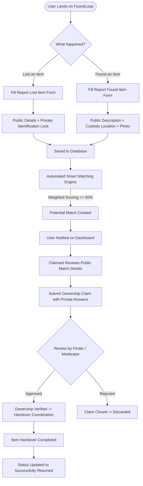

# FoundLoop – Product Requirements & Strategy Document

## 1. Executive Summary
**FoundLoop** is a community-first Lost & Found web platform engineered for real-world Indian contexts—colleges, railway and metro stations, workplaces, bus terminals, airports, and public neighborhoods. 

Rather than relying on fragmented WhatsApp groups, pinned social media notices, or informal word-of-mouth, FoundLoop centralizes lost and found reporting with:
- Structured, privacy-preserving item reporting.
- A deterministic, weighted smart matching engine (zero paid AI API dependencies).
- Multi-step ownership verification before any contact or handover coordination takes place.
- Role-based governance for community administrators and moderators.

---

## 2. Core User Personas & Roles

### A. Normal User
- **Loss Reporter (Owner):** Someone who lost an essential personal item (ID card, wallet, keys, laptop, mobile phone, documents).
- **Finder:** A good Samaritan, railway worker, student, security guard, or office receptionist who found an item and wants to return it safely without being spammed or harassed.
- **Capabilities:**
  - Create and manage lost-item reports.
  - Create and manage found-item reports.
  - Browse public-safe items with filters.
  - View calculated match suggestions with transparent reasons.
  - Submit private ownership claims for found items.
  - Track recovery lifecycle milestones.

### B. Moderator
- College campus student heads, facility managers, railway station superintendents, or verified community leads.
- **Capabilities:**
  - Review flagged or suspicious listings.
  - Check suspected duplicate reports.
  - Mediate disputed ownership claims.
  - Safeguard public listings from inappropriate text or photos.

### C. Administrator
- Platform superusers / community leaders.
- **Capabilities:**
  - Full platform governance and real-time database metrics.
  - User account status management (suspensions / reactivations).
  - Final arbitration on disputed ownership claims.
  - Permanent removal of fraudulent reports.
  - Audit trail monitoring.

---

## 3. Major User Flows

### Flow 1: Reporting a Lost Item
1. User logs in (or registers via email verification).
2. Selects **"I Lost Something"**.
3. Enters public attributes: Item title, Category, Brand, Primary & Secondary Colors, Date lost, City, Approximate area/landmark, Public description, Optional photo.
4. Enters **Private Identifying Information (Protected)**: Serial numbers, lock screen wallpaper description, secret marks, pouch contents, or unique stickers.
5. System saves the record with status `Report Submitted` and executes the matching pipeline.

### Flow 2: Reporting a Found Item
1. Finder logs in.
2. Selects **"I Found Something"**.
3. Enters: Item title, Category, Approximate location (e.g., *"Near Platform 4 Bench, Dadar Station"* or *"Library 2nd Floor, Block B"*), City, Date found, Condition, Photograph.
4. Notes custody status: In Finder's possession, handed to Security Desk, or at Lost & Found counter.
5. Finder's personal contact details remain completely masked.

### Flow 3: Smart Match Discovery & Scoring
1. Every time a new report is created or updated, the system compares it against opposite listings (Lost vs Found) in the same Category and City.
2. The deterministic algorithm computes weighted field overlaps (Category, Normalized Name, Brand, Color, Landmark keywords, Date delta).
3. Matches scoring $\ge 50\%$ are presented to both the owner and finder with visual badges:
   - **High Similarity ($\ge 75\%$)**
   - **Possible Match ($50\% - 74\%$)**
   - **Low Similarity ($30\% - 49\%$)**
4. The system lists exactly *why* it matched (e.g. *"Category: Electronics"*, *"Color: Matte Black"*, *"Location: Andheri West"*, *"Reported within 24 hours"*).

### Flow 4: Ownership Verification & Claim Submission
1. An owner viewing a matching found item cannot immediately message or take custody.
2. Owner clicks **"Claim This Item"**.
3. Form prompts for specific private proof (e.g., *"What is written on the back cover?", "Provide the first 4 digits of the card", "Describe keychain ornament"*).
4. The finder (or moderator) compares the answers against the physical item in their custody.
5. If verified, the status shifts to `Ownership Verified` and unlocks safe pickup instructions.

### Flow 5: Handover & Case Resolution
1. Handover occurs at a designated public location (Campus security desk, Station master office, Police station, or reception).
2. Both parties confirm collection.
3. Report status updates to `Successfully Returned`, celebrating community success and archiving active search notifications.

---

## 4. Privacy & Safety Guarantees (The FoundLoop Pledge)
1. **No Public Phone Numbers or Email Addresses:** Zero phone numbers, personal emails, or private residential addresses are ever rendered on public cards.
2. **Approximate Locations Only:** Listings state *"Dadar West, Mumbai"* or *"IIT Bombay Main Gate"* instead of home addresses.
3. **Sensitive Document Masking:** For Aadhaar, PAN cards, Voter IDs, College IDs, or Driving Licenses, only initials and partial dates are public.
4. **Anti-Scam Protection:** Potential owners must prove ownership *before* collection details are exchanged.
5. **Report & Flagging Mechanism:** Any user can flag questionable listings (rewards scams, abusive language, inappropriate pictures) for instant moderator triage.

